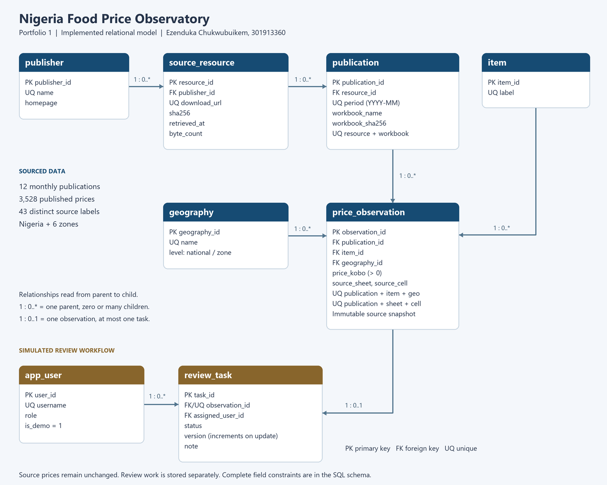

# Portfolio 1: Database design and modelling

Ezenduka Chukwubuikem | 301913360 | MIT 8103

## 1. Case study and scope

The **Nigeria Food Price Observatory** is a proposed academic system for researchers and data stewards who monitor published food prices in Nigeria. Its real data provider is the **National Bureau of Statistics (NBS)**. The proposed observatory is a simulated organisation/system, not an existing NBS application. This distinction allows authentic statistics to be used without inventing institutional processes or claiming access to NBS internal systems.

The database supports monthly data imports, retrieval of an item's published price, comparison across reporting periods and geographic levels, source tracing, and the assignment and review of data-quality questions. Analysts read prices and raise questions; stewards review them; an administrator manages imports. These roles describe the application design. SQLite has no built-in per-user access control, and the demo account table does not implement authentication or enforce role-based permissions.

The selected data cover January-December 2025. Each monthly workbook provides 42 national current-month prices and 42 prices for each of six geopolitical zones: 294 observations per month and 3,528 in total. The source collection also describes state-level price collection, but these particular spreadsheets do not provide a full state-by-item panel. State extremes, previous-year comparisons and previous-month comparison columns are outside this first import. National figures are loaded directly from NBS; they are not calculated as an unweighted mean of the six zones.

### Data boundaries

- Real source data: published national and zonal price averages, reporting labels and source metadata.
- Derived representation: prices rounded to the nearest kobo using decimal half-up rounding; original precision remains in the local source workbooks.
- Fictional application data: two clearly labelled demo users. No review tasks are seeded and no prices are fabricated.
- Missing or non-numeric prices: stop the import for investigation; do not silently replace them with zero.
- Units: preserve the item labels, including pack sizes where present. A label without an explicit unit is not automatically interpreted as a kilogram. Cross-item basket or quantity calculations are not supported without an additional verified unit dictionary.

## 2. Requirements and business rules

1. A source resource belongs to one publisher; it may contain more than one monthly workbook.
2. In this initial snapshot, each reporting month has exactly one publication. Revised releases would require a later schema migration to introduce explicit revision identifiers.
3. An observation belongs to exactly one publication, one item and one geography.
4. There can be at most one observation for a publication-item-geography combination.
5. Each imported observation identifies its source sheet and cell. The corresponding workbook and download resource are reached through foreign keys.
6. Prices must be positive integer kobo, with NGN as the sole currency in scope.
7. Imported price rows are immutable. The application tracks review work separately rather than overwriting official values.
8. A review task points to one observation and one demo user. At most one task exists for an observation in this initial design.
9. A task status is `open`, `in_review` or `resolved`. Its version increases by one on every update. Transition ordering is not enforced in Portfolio 1; Portfolio 3 will demonstrate the chosen update protocol.
10. This model supports national and zonal data only. It does not imply a state-level dataset.

## 3. Entity relationships

The companion ER diagram shows the implemented tables. `PK` means primary key, `FK` foreign key and `UQ` a unique constraint. Each child has exactly one required parent; a parent may have no child rows. A price observation may have no review task or one task.



<details>
<summary>Editable diagram source</summary>

```text
erDiagram
    publisher ||--o{ source_resource : publishes
    source_resource ||--o{ publication : contains
    publication ||--o{ price_observation : reports
    item ||--o{ price_observation : describes
    geography ||--o{ price_observation : locates
    price_observation ||--o| review_task : may_have
    app_user ||--o{ review_task : is_assigned
```

</details>

## 4. Relational schema and data dictionary

All tables are SQLite `STRICT` tables. Integer primary keys are stable surrogate identifiers. Business uniqueness is enforced separately.

| Table | Fields and constraints | Purpose |
|---|---|---|
| `publisher` | `publisher_id` INTEGER PK; `name` TEXT required UQ; `homepage` TEXT required | Stores the statistical publisher once |
| `source_resource` | `resource_id` INTEGER PK, taken from NBS download ID; `publisher_id` INTEGER required FK; `download_url` TEXT required UQ; `sha256` TEXT, 64 lowercase hex characters; `retrieved_at` TEXT required UTC timestamp; `byte_count` positive INTEGER | Identifies and verifies the downloaded XLSX or ZIP |
| `publication` | `publication_id` INTEGER PK; `resource_id` INTEGER required FK; `period` TEXT `YYYY-MM`, required UQ; `workbook_name` required TEXT; `workbook_sha256` 64-character hex; UQ (`resource_id`,`workbook_name`) | Identifies one monthly workbook inside a resource |
| `item` | `item_id` INTEGER PK; `label` nonblank TEXT required UQ | Preserves a distinct source item description |
| `geography` | `geography_id` INTEGER PK; `name` TEXT required UQ; `level` TEXT restricted to national/zone; permitted names checked | Represents Nigeria and six geopolitical zones |
| `price_observation` | `observation_id` INTEGER PK; required FKs `publication_id`,`item_id`,`geography_id`; positive INTEGER `price_kobo`; nonblank TEXT `source_sheet`,`source_cell`; UQ (`publication_id`,`item_id`,`geography_id`); UQ (`publication_id`,`source_sheet`,`source_cell`) | Stores the measurement and its exact source location |
| `app_user` | `user_id` INTEGER PK; nonblank `username` TEXT required UQ; `role` TEXT checked; `is_demo` INTEGER constrained to 1 | Holds fictional workflow participants, without passwords or real personal data |
| `review_task` | `task_id` INTEGER PK; `observation_id` INTEGER required FK UQ; `assigned_user_id` INTEGER required FK; checked `status` TEXT; nonnegative INTEGER `version`; required TEXT `note` | Holds mutable review work separately from published prices |

The `published_prices` view joins the measurement to its item, geography, period and source details. Its `price_ngn` column is a display conversion, not a separately stored amount. Use integer kobo for exact comparisons and arithmetic where possible.

Foreign-key deletion defaults to `NO ACTION`, preventing deletion of referenced parents. SQLite requires `PRAGMA foreign_keys=ON` on each connection, which the build code sets explicitly. Two triggers reject updates and deletions of source observations. Another trigger checks the task version increment. It does **not** by itself prevent lost updates: the writer must also include the last-seen version in its `WHERE` clause and check that exactly one row changed.

## 5. Normalisation

### Starting structure and first normal form

The regional spreadsheet has one item per row and six regional price columns. Treating the regions as repeating attributes makes adding a geography a schema change. Unpivoting those columns produces atomic rows: `(publication, item, geography, price, source cell)`. No cell in the relational schema contains a list of observations. Source archive contents are represented by related publication rows, rather than a list in a resource field.

### Second normal form

The observation's natural candidate key is `(publication_id, item_id, geography_id)`. The price depends on the whole combination. Item descriptions depend only on `item_id`; geographic details only on `geography_id`; publication details only on `publication_id`. Those attributes are stored in their own tables rather than repeated for every price. This removes partial dependencies on components of the observation's natural key, even though a surrogate `observation_id` is also used.

### Third normal form

The important functional dependencies are:

| Determinant | Dependent attributes |
|---|---|
| `publisher_id` | publisher name, homepage |
| `resource_id` | publisher ID, URL, hash, retrieval time, size |
| `publication_id` | resource ID, period, workbook name, workbook hash |
| `item_id` | item label |
| `geography_id` | geography name, level |
| `observation_id`, or its natural candidate key | price and source coordinates |
| `user_id` | username, role, demo flag |
| `task_id`, or its unique observation ID | assignee, status, version, note |

Publisher details are not repeated in publication rows, source download details are not repeated in observation rows, and user details are not repeated in task rows. For example, the path `observation -> publication -> source resource -> publisher` is represented through related tables instead of creating a transitive dependency inside one wide observation table. Other declared unique keys, such as the item label and publication period, are alternate determinants under the stated business rules. Non-key descriptive attributes therefore depend on keys in their own relations.

### Anomalies avoided

- **Update:** changing a publisher homepage affects one publisher row, not thousands of price rows.
- **Insertion:** an item or geography can be registered before prices exist.
- **Deletion:** removing a disposable review task does not erase the referenced price or its source. Source price deletion is intentionally blocked.

No month-on-month percentage or zonal aggregate is stored redundantly in the base tables. Portfolio 2 will calculate comparisons from like-for-like observations. Retaining both an official national statistic and official zonal statistics is intentional: the national figure is independently sourced and is not assumed to be the arithmetic average of the zones.

## 6. Source problems and decisions

The March and April files contain a national worksheet titled `Selected Food Dec 2024`. Their current-month column headers identify March and April 2025. The importer derives the reporting period from that header and checks it against the expected period in the source manifest. This prevents a worksheet-title error from assigning valid values to the wrong month.

National sheets label one series `Smoked fish (Mackerel)` while regional sheets use `Smoked fish`. No evidence establishes that these descriptions can safely be merged. Both labels are retained, so the database has **43 distinct labels**, even though each individual table contains 42 items. Cross-level queries must not join those two series by guesswork.

Whitespace and trailing commas are normalised; spelling, product descriptions and pack sizes are preserved. These cosmetic changes bring variants such as `Agric hen eggs, ` together without collapsing semantically different descriptions.

Checksums pin the 11 downloaded resources. The August-September archive contains two workbooks, explaining why there are 11 resources and 12 publications. A changed download hash causes a failure for review rather than silently replacing the dataset. For standalone XLSX downloads, the workbook name is a documented resource-based local identifier; for ZIP downloads, the archive member name is preserved.

## 7. Implementation and practical evidence

The implementation uses Python 3.12.14, SQLite 3.53.1 and openpyxl 3.1.5 in the recorded build. SQLite provides a runnable local relational database without requiring an uninstalled server. The database file remains local because it contains NBS source data. SQL, Python, source metadata, the diagram and aggregate validation results are included in the portfolio.

The build validates source structure before insertion, loads the database in a transaction, runs integrity checks and only then publishes the database file. It refuses to overwrite an existing database, preserving any later review work. The validation command rereads the source workbooks and reconciles all 3,528 database observations to their values and provenance. The separate test suite uses fictional in-memory fixtures to challenge constraints and importer edge cases.

See the accompanying verification report and test log for actual results. The presence of version fields and a rollback unit test does not complete Portfolio 3; a separate two-connection concurrency exercise is still required. Similarly, no query optimisation, NoSQL implementation or cloud deployment is claimed in Portfolio 1.

## 8. Fit for later portfolios

| Portfolio | Planned use of this case study |
|---|---|
| 2 | Joins, like-for-like monthly changes, regional ranking, query plans and measured indexes. Report limited scale honestly; any later benchmark expansion must be distinctly labelled synthetic. |
| 3 | Two reviewers updating the same task, atomic assignment, rollback and isolation. Preserve imported prices. Explain SQLite's single-writer behaviour explicitly. |
| 4 | Implement monthly regional documents with nested item prices in a real document store; compare duplicated document data with the relational model. |
| 5 | Discuss or exercise a central write service with regional read replicas, report refreshes, availability and consistency. SQLite alone is not a distributed database. |

## 9. References and source access

1. National Bureau of Statistics, Nigeria. *Selected Food Price Watch*, January-December 2025 tables. https://microdata.nigerianstat.gov.ng/index.php/catalog/162/related-materials (accessed 2 October 2026). Individual download URLs and SHA-256 values appear in the source manifest.
2. National Bureau of Statistics. *Terms & Conditions*. https://www.nigerianstat.gov.ng/page/terms (accessed 2 October 2026). Public download availability is not treated as an unrestricted redistribution licence.
3. SQLite. *Foreign Key Support*. https://www.sqlite.org/foreignkeys.html (accessed 2 October 2026).
4. SQLite. *CREATE TABLE*. https://www.sqlite.org/lang_createtable.html (accessed 2 October 2026).
5. SQLite. *Isolation in SQLite*. https://www.sqlite.org/isolation.html (accessed 2 October 2026).

This document is the detailed Portfolio 1 explanation, not the final 2-3 page semester summary. AI-assisted design, code and documentation require the student's review and are recorded in the project AI-use log.
