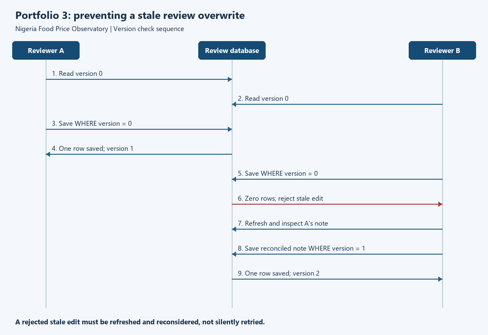

# Portfolio 3: Transactions and concurrency

Ezenduka Chukwubuikem | 301913360 | MIT 8103

## Case study and scope

The Nigeria Food Price Observatory preserves published NBS observations while analysts review their provenance and labels. Reviewers change `review_task`, not immutable price records. This phase tests saving, cancelling and conflicting edits through independent database connections.

The experiment uses a fresh local copy of the Portfolio 1 database containing 3,528 real observations. Nine **fictional demonstration tasks** reference existing observations. Their `DEMO:` notes describe simulated actions, not actual checks performed by NBS or the student. No raw prices or populated databases are exported.

The executed run is **20261003T220409895229Z**. All **nine scenarios passed**, the original database hash remained unchanged, and integrity and foreign-key checks passed. [Transaction Evidence](Ezenduka_Chukwubuikem_301913360_Transaction_Evidence.md) contains actual step outputs. Its JSON counterpart also records SQL by connection. The [HTML viewer](Ezenduka_Chukwubuikem_301913360_Evidence_Preview.html) presents the captured results with expandable SQL traces; it is generated evidence, not a screenshot.

## Transaction design

Every accepted task update increments `version` exactly once, as required by the Portfolio 1 trigger. This increment alone does **not** verify that a reviewer edited the latest row. The application must compare the version originally loaded:

```sql
BEGIN IMMEDIATE;
UPDATE review_task
SET note = :note, status = :status, version = version + 1
WHERE task_id = :task_id AND version = :loaded_version;
-- Application checks affected rows:
-- one -> COMMIT; zero -> ROLLBACK and report conflict/missing task.
```

The implemented `guarded_edit` function binds parameters, checks the affected count and rolls back on exceptions before propagating them. A missing task also returns false; an interface would reread to distinguish it from a version conflict. Invalid status values remain errors. This is a database demonstration, not an authenticated review application.



<details>
<summary>Editable diagram source</summary>

```text
sequenceDiagram
    participant A as Reviewer A
    participant DB as Review database
    participant B as Reviewer B
    A->>DB: Read version 0
    B->>DB: Read version 0
    A->>DB: Save WHERE version = 0
    DB-->>A: One row saved, version 1
    B->>DB: Save WHERE version = 0
    DB-->>B: Zero rows, reject stale edit
    B->>DB: Refresh and inspect A's note
    B->>DB: Submit reconciled note WHERE version = 1
    DB-->>B: One row saved, version 2
```

</details>

The final edit simulates a consciously reconciled request. An application must not automatically resubmit an old note with a newly fetched version, which would defeat conflict detection.

## Executed scenarios

| Case | Action | Verified result |
|---|---|---|
| T01 commit/reopen | A edits; B reads before commit; new connection C reads after commit | A sees version 1 while B sees version 0. C sees saved version 1. |
| T02 atomic rollback | First update succeeds; second violates the status constraint | `SQLITE_CONSTRAINT_CHECK` (275). First edit remains pending until explicit rollback; both tasks then match their original states. |
| T03 savepoint | Keep an initial edit, make an optional edit, roll back to savepoint and commit | Initial note/version 1 survive; optional note/version 2 do not. |
| T04 unsafe stale form | Both load version 0; A saves; B later saves without a version predicate | B replaces A's note; version becomes 2. Increment trigger accepts both. |
| T05 version guard | A saves version 0; B attempts its old version 0 | B affects zero rows and A's note remains. Refresh and reconciled submission then produce version 2. |
| T06 reader snapshot | A begins and reads; B commits; A reads again | A keeps seeing version 0 until ending its read transaction, then sees version 1. |
| T07 stale snapshot write | A reads version 0 in a transaction; B commits version 1; A tries to write | `SQLITE_BUSY_SNAPSHOT` (517). A rolls back, refreshes and submits a reconsidered edit in a new transaction. |
| T08 writer contention | A holds `BEGIN IMMEDIATE`; B attempts the same | B gets `SQLITE_BUSY` (5), but can read committed state. After A commits, B rereads and successfully edits. |
| T09 error cleanup | Omit version increment, use invalid FK/status, edit missing task | Constraints reject invalid writes; helper leaves no transaction or partial edit; missing task is not reported as saved. |

SQL trace callbacks can repeat statements during trigger execution. Repeated lines do not mean repeated committed actions; state assertions and transaction boundaries establish outcomes.

## Interpreting concurrency

Two independent SQLite connections are interleaved deliberately in one process. Transactions overlap where specified, producing real locks, snapshots and error codes. This is a controlled schedule, not a threaded throughput benchmark or sleep-based race.

T04 is an **application-level lost edit** across separate, successfully serialised transactions: the reviewer retained old form data between reading and saving. SQLite did not permit simultaneous writers or violate isolation. Writer locking protects a short database transaction; the version predicate protects a long-lived form without keeping a lock open while a person thinks.

In WAL mode a reader can retain an earlier snapshot while a writer commits, but SQLite still permits only one writer. An obsolete snapshot cannot become a writer after another connection commits. These distinctions explain T06-T08. See [SQLite isolation](https://www.sqlite.org/isolation.html) and [transaction control](https://www.sqlite.org/lang_transaction.html).

`busy_timeout=0` makes contention immediately observable. An application could use bounded waiting/backoff for writer contention and then validate its request. Waiting alone does not repair an obsolete snapshot or justify overwriting someone else's work; those cases require transaction restart and conflict handling.

## ACID evidence and limits

- **Atomicity:** T02 cancels both operations after failure. A statement-level constraint abort does not itself undo earlier successful statements. T03 demonstrates partial savepoint rollback separately.
- **Consistency:** status checks, foreign keys and the version trigger are exercised; final integrity checks pass. Not every business rule is modelled: for example, allowed status values are enforced, but a status-transition graph is not.
- **Isolation:** T01 prevents uncommitted reads; T06 verifies stable WAL reads; T07/T08 exercise snapshot and lock conflicts. Shared cache is not enabled and `read_uncommitted` is off.
- **Durability evidence:** T01 reopens a connection and reads committed state with `synchronous=FULL`. This is normal commit/reopen evidence, not a power-loss, operating-system crash or hardware-failure test.

The captured environment is Python 3.12.14, SQLite 3.53.1. Each connection enables foreign keys and uses explicit transactions (`isolation_level=None`). Settings and the runner hash are in JSON. The original database is opened read-only for backup and checked by SHA-256 before/after. The populated copy remains local. No schema migration or source-price changes are made.

This phase does not establish multi-server behaviour, production security, transaction throughput or correctness under every possible schedule. Follow the [README](Ezenduka_Chukwubuikem_301913360_Portfolio3_README.md) to repeat these nine defined scenarios; the harness stops on any mismatch.

## References and student review

- NBS Selected Food Price Watch manifest and schema: Portfolio 1. Reviewer workflow is a simulated academic scenario.
- SQLite, [Isolation in SQLite](https://www.sqlite.org/isolation.html), accessed 3 October 2026.
- SQLite, [Transaction control](https://www.sqlite.org/lang_transaction.html), accessed 3 October 2026.

Codex assisted with implementation, execution, verification and explanation. Student review remains pending. Inspect the evidence and explain why T04 can lose a note despite writer locking, why T02 needs explicit rollback, and why T07 requires a fresh transaction. Record your own observations in the AI-use log before writing the personal reflection.
