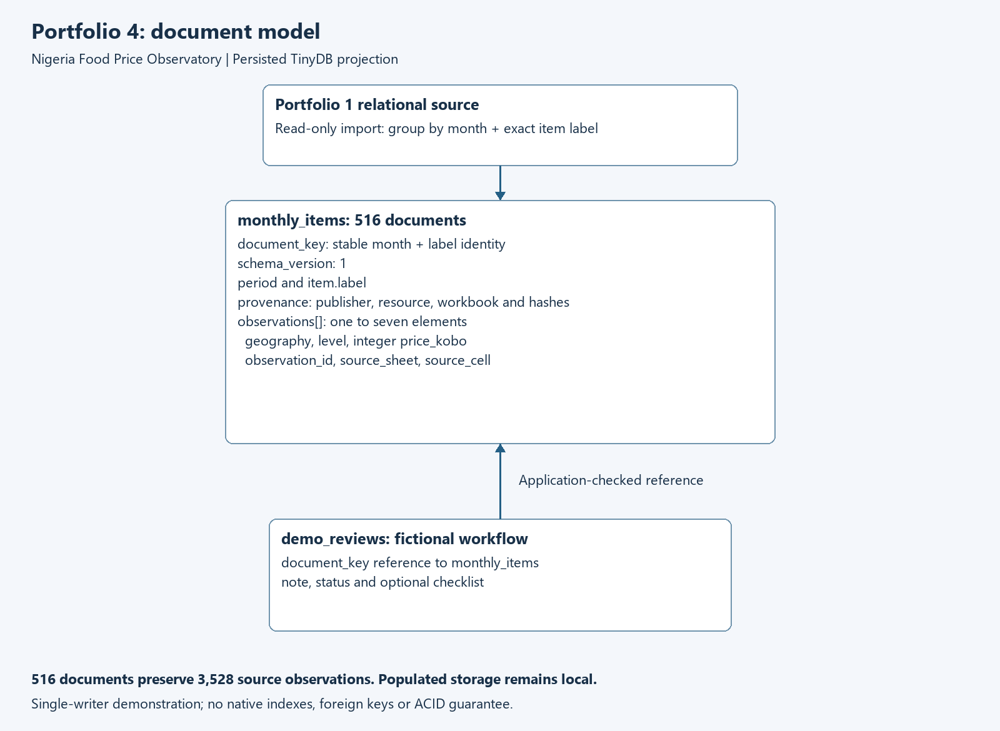

# Portfolio 4: NoSQL and advanced data models

Ezenduka Chukwubuikem | 301913360 | MIT 8103

## Implemented case study

This phase implements a **document-oriented model** of the Nigeria Food Price Observatory using **TinyDB 4.9.0**, a Python document database with persistent JSON storage. It is an executed database implementation using TinyDB's insert/search/update/remove APIs, not merely a proposed JSON layout or SQLite JSON query.

The use case is a local analyst reading one item's monthly national and regional observations together. The original relational database remains the source of truth. The document store is a reproducible read-oriented projection plus clearly fictional single-user workflow examples. It does not replace Portfolio 3's multi-reviewer transaction controls.

Recorded run: **20261003T223205428931Z**. The persisted store contains **516 documents**, preserving **3,528 source observations**. After closing and reopening it, every flattened source field matched the SQLite input, including source cells and provenance. All six query results matched independent SQL references. Twelve semantic/persistence tests passed.

## Document structure and boundaries

One `monthly_items` document represents **one calendar month and one exact source item label**. Its observations array embeds the national and available zonal values. Each element retains integer kobo, geography, geographic level, original observation ID, source sheet and cell. Provenance is shared at document level because all embedded observations belong to the same source publication.



<details>
<summary>Editable diagram source</summary>

```text
flowchart TD
    R[Portfolio 1 relational source] --> G[Group by month and exact item label]
    G --> M[monthly_items: 516 documents]
    M --> I[document_key and schema_version]
    M --> P[period and item.label]
    M --> S[publication provenance]
    M --> O[observations array: 1 to 7 elements]
    O --> V[geography, level, integer price_kobo]
    O --> C[observation_id, source_sheet, source_cell]
    W[demo_reviews: fictional workflow] -->|document_key reference| M
```

</details>

| Field | Purpose and rule |
|---|---|
| `schema_version` | Integer 1; unknown versions rejected by this importer |
| `document_key` | SHA-256 of the canonical JSON pair `[period, exact item label]`; stable application identity |
| `period` | Valid `YYYY-MM` reporting month |
| `item.label` | Preserved source label; no inferred unit or label merging |
| `provenance` | Publisher, resource ID/URL/hash, workbook name/hash |
| `observations` | One to seven embedded observations, each for a distinct valid geography |
| `demo_reviews.document_key` | Application-checked reference to a monthly item |
| `demo_reviews.note/status/checks` | Fictional review note, permitted status, optional checklist |

TinyDB's internal integer `doc_id` is a storage identifier. References use `document_key` so that rebuilding the snapshot need not preserve insertion IDs. No claim is made that hashing is a database uniqueness constraint: the importer checks for duplicates before insertion.

Each month has 43 documents. Across twelve months, **492 documents contain seven observations**, **12 contain six**, and **12 contain one**. The two source fish labels remain separate: `Smoked fish` has zonal coverage while `Smoked fish (Mackerel)` has national coverage. Missing coverage is represented by absent elements, not fabricated prices or zeros. The observations reconcile as `492 × 7 + 12 × 6 + 12 × 1 = 3,528`.

The [fictional example](Ezenduka_Chukwubuikem_301913360_Fictional_Document_Example.json) is a complete example document with explicitly invented prices, a fictional publisher and an invalid example-domain URL. Actual source documents remain local because of the source-use restrictions documented in Portfolio 1.

## Why embed observations and reference reviews?

Embedding gives a monthly item page all of its regional observations and provenance in one returned document. Keeping each month separate bounds the observations array and avoids a single ever-growing history document. The tradeoff is repeated publication metadata across item documents. Import validation checks that provenance agrees within each document; rebuilding from the authoritative source avoids informal divergent copies.

Mutable review notes are stored separately so workflow changes do not rewrite the snapshot's meaning. A single-writer application checks the referenced key before inserting a review. TinyDB does not provide foreign-key enforcement, so bypassing that function can create dangling references. Similarly, snapshot immutability here is an importer/application convention, not a database trigger or access-control boundary.

The optional review checklist demonstrates a flexible document field without altering the price-document structure. Flexibility does not remove validation: Python checks required fields, schema version, integer prices, provenance, geography uniqueness, observation ID reuse and duplicate keys. Failed batch validation occurs before insertion, but that is not a crash-safe transaction guarantee.

## Executed document queries

| Query | Purpose | Actual matched documents |
|---|---|---:|
| D01 | December 2025 `Rice Local, short-Grained` document | 1 |
| D02 | December documents containing a national observation | 42 |
| D03 | Documents without a national observation | 12 |
| D04 | Documents without zonal observations | 12 |
| D05 | Documents where the same array element is Nigeria and has at least 100,000 kobo | 453 |
| D06 | All months for the focus rice label | 12 |

For each query, the exact sorted `(period, label)` result identities match an independent SQL statement on the original source; the evidence records identity hashes and the reference SQL. D05 is a database filtering demonstration, not a comparison of product value across potentially different units or an inflation measure.

Example executed predicates from the runner:

```python
d, o = Query(), Query()
snapshots.search((d.period == '2025-12') & (d.item.label == FOCUS))
snapshots.search(d.observations.any(
    (o.geography == 'Nigeria') & (o.price_kobo >= 100000)))
```

Both conditions in the second query must match the **same array element**. Two separate `any` tests could incorrectly use Nigeria's name and another region's price. A fictional edge-case test reproduces that incorrect match and verifies that the implemented combined predicate excludes it.

## Implemented CRUD and persistence

The runner imports documents using `insert_multiple`, closes the database and reopens it before comparing all 3,528 source rows. It then inserts a fictional `demo_reviews` document, retrieves it, changes its status/note and adds a checklist, and inserts then removes a separate temporary draft. Another close/reopen verifies the retained updated review and the draft's absence.

The snapshot document hash is unchanged by review CRUD. The original SQLite file's before/after SHA-256 also matches. These are ordinary persistence and preservation checks, not proof of ACID or fault-tolerant storage. No real NBS review is claimed by the demonstration notes.

See [actual NoSQL results](Ezenduka_Chukwubuikem_301913360_NoSQL_Evidence.md), the matching JSON, [test log](Ezenduka_Chukwubuikem_301913360_Test_Log.txt) and [visual evidence page](Ezenduka_Chukwubuikem_301913360_Evidence_Preview.html). The HTML is generated from captured results and is not presented as a screenshot of a separate application.

## Suitability and limitations

TinyDB is suitable for this small, embedded, single-writer document demonstration. Its official documentation identifies native indexes, multi-process/thread access and ACID guarantees as unsupported needs. The implementation uses no native index and disables query-result caching; caching is not an index. See the [TinyDB introduction](https://tinydb.readthedocs.io/en/latest/intro.html).

| Concern | This document implementation | Portfolio 1/3 relational implementation |
|---|---|---|
| Monthly item retrieval | Embedded observations in one document | Joins across normalised tables |
| Constraints | Explicit Python checks; direct API calls can bypass them | SQLite constraints and triggers |
| Concurrent review editing | Single writer only; no concurrency safety claim | Tested transaction locking and version predicate |
| Optimisation | No native indexes or speed claim | Portfolio 2 measured covering indexes |
| Metadata changes | Repeated embedded provenance must remain consistent | Shared referenced publication/resource records |
| Recovery | Rebuild projection from source; no crash-recovery test | Transaction mechanisms demonstrated, still no hardware-failure test |

For a shared production service, SQLite remains the safer implemented workflow store. A server document engine with suitable indexing, validation and atomic-update guarantees could be evaluated separately; this portfolio does not claim to have installed or tested MongoDB. TinyDB API behaviour for nested arrays, document identifiers, caching and mutation is documented in [Advanced Usage](https://tinydb.readthedocs.io/en/latest/usage.html).

## Reproduction, references and ownership

Follow the [Portfolio 4 README](Ezenduka_Chukwubuikem_301913360_Portfolio4_README.md). Python 3.12 or later and pinned TinyDB 4.9.0 are used. Each run creates a new local directory. No populated JSON database or source prices are published. The test suite uses fictional data only.

Sources: Portfolio 1 NBS source manifest; TinyDB's [introduction](https://tinydb.readthedocs.io/en/latest/intro.html) and [usage documentation](https://tinydb.readthedocs.io/en/latest/usage.html), consulted 3 October 2026. The observed engine version and runtime hashes are recorded in evidence.

Codex assisted with design, coding, execution and explanation. Student review remains pending. Before the final reflection, explain the document boundary, the separate fish labels, the same-element array test, and why this database is not used for concurrent reviewer updates. Record actual personal checks and learning in the AI-use log.
