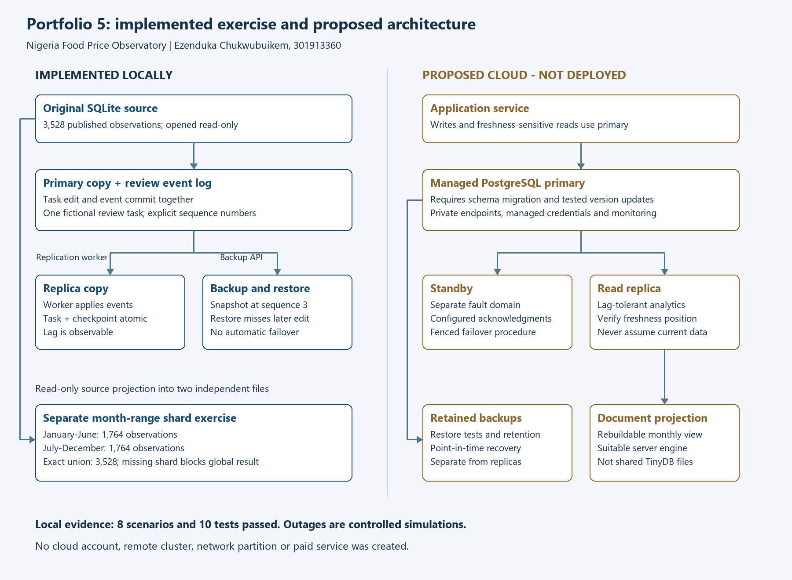

# Portfolio 5: Distributed and cloud database exercise

Ezenduka Chukwubuikem | 301913360 | MIT 8103

## Scope: executed exercise versus proposed deployment

The Nigeria Food Price Observatory has two different needs: readers can often tolerate a slightly old analytical view, while reviewers must not mistake an unreplicated edit for their latest saved work. This phase implements a **local controlled exercise** for those tradeoffs and proposes a cloud architecture for the same case study.

The implemented primary, replica, restored database and two shards are **separate SQLite files on this computer**, orchestrated in one Python process. Pausing the replication worker and setting availability flags simulate failures. They are not network partitions, separate servers or cloud deployments. The source database remains unchanged; all workflow notes are fictional `DEMO:` records.

The assessment permits a distributed/cloud discussion or setup. The practical evidence here supplements the architecture discussion without claiming a service was deployed. Run **20261004T110216717910Z** passed **eight integration scenarios**, and **ten focused failure/routing tests** passed.

## Implemented replication model

The runner starts with a snapshot copy of the Portfolio 1 database. It adds one fictional review task, an append-style `demo_replication_log` and a single-row `demo_replica_progress` table. A backup of that initial state seeds the replica at sequence zero. This is an educational application-level replication mechanism for the single seeded review task; it does not stream arbitrary SQL changes or future NBS imports.

Each primary edit changes the task and inserts its event **in the same SQLite transaction**. An event contains its sequence, task ID, previous/new version, status and note. The acknowledged sequence is returned only after commit. A failing event insert must therefore roll back the task edit too; a dedicated test verifies that failure path.

The explicit replication worker reads events newer than the replica's applied sequence, checks sequence continuity and expected task version, applies the updates and advances the checkpoint in one replica transaction. A gap or conflicting version causes rollback, rather than silent overwrite. After commit, a repeated call sees no pending events. These are safe retry results under a **single worker and stable local files**, not a general exactly-once distributed-delivery guarantee. The log has no retention/compaction or production administration layer.

Initialisation and recovery use SQLite's backup API rather than manually copying a live database file. [SQLite's documentation](https://www.sqlite.org/backup.html) describes this API as a way to produce database snapshots. The exercise validates snapshot integrity and foreign keys and keeps populated copies local.

## Consistency and read routing

The router accepts `minimum_sequence`, representing the caller's required acknowledged write. If the replica has applied that sequence, it can serve the read. If behind, a strict request routes to the available primary; if the primary is unavailable, it returns an error. An explicitly non-strict request may return the replica value with `satisfies_minimum: false`.

This provides a demonstrated minimum-version/read-your-write policy for the controlled schedule. It is not a claim that every replica read is globally latest or linearizable. A client that asks for sequence zero has not asked for later edits. A production routing implementation would need consistent database-level reads and a reliable replication-position protocol under real concurrency.

The primary acknowledges before replication, so the exercised mechanism is asynchronous. A paused worker can leave the replica indefinitely behind: convergence requires the worker to resume and succeed. A read replica improves potential read availability but must not be treated as a current writable primary automatically.

## Actual scenario results

| Scenario | Observed outcome |
|---|---|
| S01 initial snapshot | Primary and replica both contain task version 0; replica checkpoint is 0. |
| S02 paused worker | Two primary edits are acknowledged. Primary is at version/sequence 2; replica remains at 0. Non-strict read is labelled stale; strict read uses the primary. |
| S03 simulated primary outage | With required sequence 2, a strict read and a write are refused. Non-strict replica read returns version 0 with an explicit stale flag. No replica promotion occurs. |
| S04 catch-up and repeat | Resuming the worker applies two events and reaches checkpoint 2. A repeat applies zero events and does not duplicate edits. |
| S05 injected worker error | Failure after the task update but before its checkpoint rolls both changes back. Task/checkpoint remain at 2; retry applies one event and reaches 3. |
| S06 restore recovery point | A backup at sequence 3 is restored after the primary has acknowledged sequence 4. The restored copy lacks one acknowledged edit; its source observations still match. |
| S07 range shards | January-June and July-December hold 1,764 observations each. Their ordered union equals all 3,528 source projection rows with no overlapping observation IDs. |
| S08 missing shard | A global read refuses to return a supposedly complete result when a required shard is absent. It does not create a new empty database in its place. |

Full outputs and checksums are in [Distributed Evidence](Ezenduka_Chukwubuikem_301913360_Distributed_Evidence.md) and its JSON counterpart. [The test log](Ezenduka_Chukwubuikem_301913360_Test_Log.txt) covers stale primary edits, event-log insertion failure, mid-batch rollback, repeat replay, log gaps, replica divergence, routing, outage refusal, shard boundaries and missing files.

## Sharding choices

The two local shard files hold a flattened observation projection with item/geography labels, integer prices and source resource/workbook/cell provenance. They are not independently writable copies of the complete relational model. `shard_for` explicitly supports the imported 2025 range and rejects unconfigured years or invalid months.

Month-range routing makes a single-month analysis target one shard, while a year-wide query must combine both. The same source item can occur in both shards; no assumption is made that a shard contains a complete item history. A missing shard must not silently shrink a global aggregate. The current router materialises the combined rows in memory to verify correctness; it is not a scalable distributed query planner.

For only 3,528 observations, production sharding is unnecessary complexity. This exercise demonstrates routing, completeness and loss of partial availability, not a measured speed improvement. With future growth, time partitions in one database would be the first option to evaluate. Actual multi-server sharding would require routing metadata, cross-shard query semantics, rebalancing and a clear approach to transactions crossing shard boundaries.

## Proposed cloud architecture — not deployed

A future deployment could use an application service with a managed PostgreSQL primary and a standby in a separate fault domain. The normalised source tables and reviewer workflow remain authoritative. A read replica could serve lag-tolerant analytics, and a rebuildable document projection could support monthly item pages. The TinyDB file from Portfolio 4 should not be shared among concurrent web workers.

Writes and freshness-sensitive reads should use the primary unless the service can verify a replica's required apply position. Asynchronous replication trades delayed visibility and potential loss of unreplicated commits on failover for fewer replication waits. A configured synchronous standby can increase commit waiting and reduce write availability when the required acknowledgement cannot be obtained. Exact guarantees depend on configuration, durable storage and the promotion procedure; see [PostgreSQL standby documentation](https://www.postgresql.org/docs/current/warm-standby.html).

This proposal requires a tested SQLite-to-PostgreSQL migration, including strict typing assumptions, integer-kobo constraints, trigger syntax and the conditional version update. The SQLite scripts are not presented as directly deployable PostgreSQL migrations.

Before deployment, the design would require:

- Private database endpoints, encrypted connections/storage, managed credentials and least-privilege application roles.
- Tested backups with retention and point-in-time recovery, kept separately from ordinary read replicas.
- Monitoring of replication lag, apply position, write failures, storage capacity and backup/restore outcomes.
- A failover process that fences the former primary before permitting a new writer, plus a tested failback/rejoin procedure.
- Verified source-data hosting/redistribution permissions, resource sizing and approved operating costs.

No provider account, server, network endpoint, cloud backup or paid resource has been created in this phase.

## Availability, recovery and tradeoffs

The simulated outage policy favours freshness for review operations: writes stop and reads with an unmet sequence requirement fail. Historical analytics may continue with an explicit stale label. This illustrates a policy tradeoff under a simulated fault, not a formal measurement of CAP availability or a proof about a real partitioned system.

The restore exercise exposes the recovery point: restoring the sequence-3 backup after acknowledging sequence 4 loses one workflow edit. It measures loss in **acknowledged edits**, not elapsed seconds. No production RPO/RTO target, uptime percentage or automatic failover time has been measured. A replica can reproduce a bad write and is not a substitute for versioned backups.

Automatic replica promotion is intentionally absent because a lagging replica could lose acknowledged changes, and an unfenced old primary could produce divergent writes. Missing log entries and replica divergence are detected, but the implementation does not repair them automatically; reseeding and reconciling accepted work would require an explicit recovery procedure.

## Evidence, reproducibility and ownership

The run uses Python 3.12.14 and SQLite 3.53.1, with foreign keys enabled and `synchronous=FULL` on opened node connections. Runtime files stay in a timestamped local directory. The original source SHA-256 is unchanged. Code, aggregate counts, hashes and fictional workflow states are the only published evidence; populated database files remain excluded.

Follow the [Portfolio 5 README](Ezenduka_Chukwubuikem_301913360_Portfolio5_README.md) to reproduce. The HTML viewer provides the executed scenario results without relying on Mermaid rendering.

References: Portfolio 1's NBS source manifest; [SQLite Backup API](https://www.sqlite.org/backup.html); [PostgreSQL standby servers](https://www.postgresql.org/docs/current/warm-standby.html), consulted 4 October 2026. PostgreSQL is referenced for the proposed architecture and has not been deployed or tested in this project.

Codex assisted with design, implementation, execution and documentation. Personal student review remains pending. Explain why an acknowledged edit may be absent from a replica or backup, why a stale replica must not be promoted casually, and why a missing shard prevents a complete global result. Record your own verification and learning before the final reflection.
